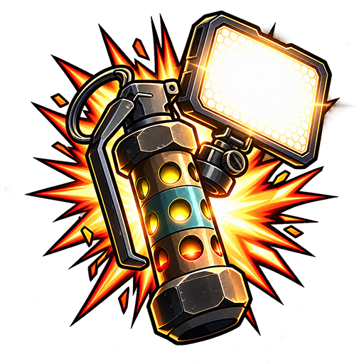

<!-- HEADER -->
<p align="center">
  
</p>

<!-- MAIN INFORMATION -->
<p align="center">
  <a href="#-cs2-flash-fx">Overview</a> •
  <a href="/CHANGELOG.md">Changelog</a> •
  <a href="https://nicekype.de">Website</a> •
  <a href="https://github.com/NiceKype/CS2FlashFX?tab=License-1-ov-file">License</a><br>
  
  
  
  
  
  
  
</p>

<br>

<!-- DESCRIPTION -->
#  CS2 Flash FX
**CS2 Flash FX** synchronizes your Elgato Key Lights with flashbang effects in Counter-Strike 2 using Game State Integration.
When you get flashed in CS2, your configured Key Lights automatically switch to the configured flash brightness and color temperature before returning to their normal state.

> [!WARNING]
> CS2FlashFX is currently in **Alpha**. Features, configuration formats and behavior may change before the first stable release.

<br>

<!-- FEATURES -->
## Features

- Counter-Strike 2 flashbang detection via Game State Integration
- Support for multiple Elgato Key Lights
- Configurable flash brightness
- Configurable flash color temperature
- Configurable effect duration
- Configurable normal lighting state
- Automatic CS2 installation detection
- Built-in GSI configuration installer and repair function
- Manual CS2 path selection
- System tray support
- Enable or disable Flash Effect directly from the tray
- Single-instance protection
- Automatic update checks via GitHub
- Built-in self-updater
- SHA-256 verification before installing updates
- Portable single-file application
- No installer required

<br>

## Requirements

- Windows 10 or Windows 11 x64
- Counter-Strike 2
- At least one compatible Elgato Key Light
- Key Light and PC connected to the same local network
- Internet connection for update checks

CS2 Flash FX is published as a self-contained application, so no separate .NET installation is required.

<br>

## Installation

1. Download `CS2FlashFX.exe` from the latest GitHub release.
2. Save the application anywhere you want.
3. Start `CS2FlashFX.exe`.
4. Open the **Settings** tab.
5. Verify or select your Counter-Strike 2 installation.
6. Click **Install Integration**.
7. Restart Counter-Strike 2 if it is already running.
8. Configure your Key Light IP addresses and lighting values.
9. Enable **Flash Effect**.

No traditional installation is required.

<br>

## CS2 Integration

CS2 Flash FX requires a Game State Integration configuration to receive flash information from Counter-Strike 2.

The application automatically creates:

```text
game\csgo\cfg\gamestate_integration_cs2flashfx.cfg
```

<br>

<!-- SUPPORT -->
## 》SUPPORT
[](https://discord.gg/nicekype)

<br>

<!-- LICENSE -->
## 》LICENSE
🛡️ This tool is licensed under: [NKS-Public-License (NKPL-1.1)](/LICENSE) – see terms before using or modifying this code.
